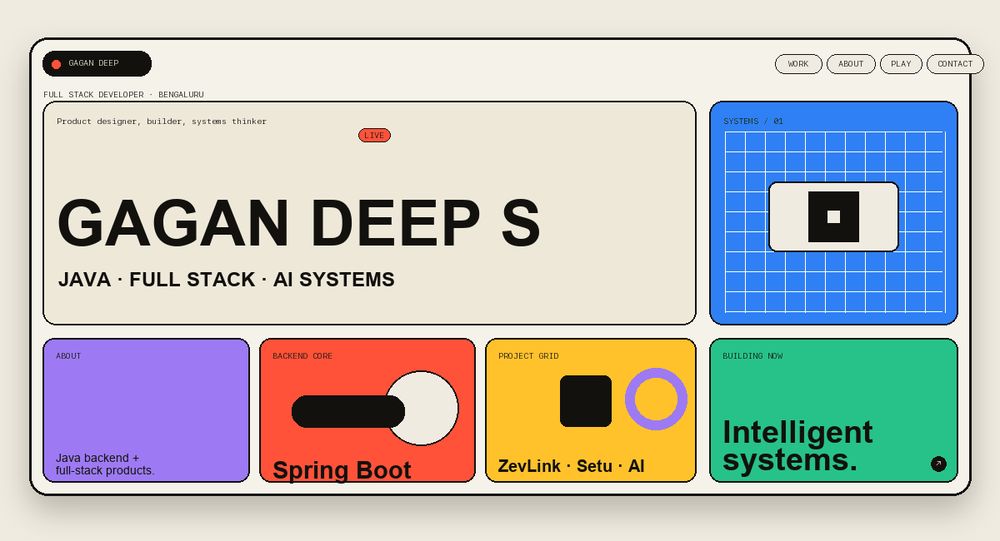
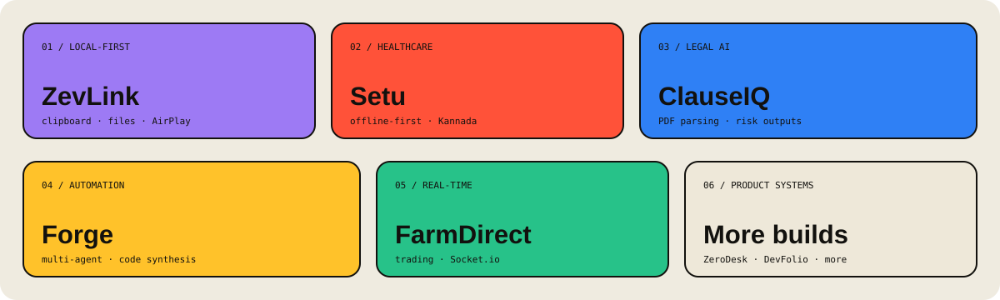
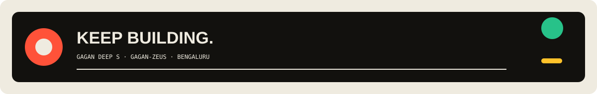

<p align="center">
  
</p>

<p align="center"><sub><a href="profile-assets/hero.svg">Open the static SVG fallback ↗</a></sub></p>

<p align="center">
  <a href="https://github.com/Gagan-Zeus"></a>
  <a href="https://portfolio-gagan-s.vercel.app/"></a>
  <a href="https://linkedin.com/in/gagan-deep-s-6304b0398"></a>
</p>

<p align="center">
  <code>JAVA / SPRING BOOT</code> &nbsp;·&nbsp; <code>REACT / REST / SQL</code> &nbsp;·&nbsp; <code>AI AUTOMATION</code> &nbsp;·&nbsp; <code>BENGALURU</code>
</p>

<p align="center">
  
</p>

## 01 / PROFILE INDEX

```text
> opening profile index...
> backend systems ............ ready
> product systems ............ ready
> identity: GAGAN DEEP S
```

I am a **Full Stack Developer**, **Java backend engineer**, and **AI enthusiast** building efficient,
high-performance, data-driven software systems. My centre of gravity is Java, Spring Boot, REST APIs,
SQL-backed systems, and clean object-oriented design — with a growing orbit around AI agents, LLM
integrations, and automation.

<p align="center">
  <a href="#02--about">ABOUT</a> &nbsp;·&nbsp;
  <a href="#03--technical-arsenal">TOOLKIT</a> &nbsp;·&nbsp;
  <a href="#04--project-grid">PROJECTS</a> &nbsp;·&nbsp;
  <a href="#06--education">EDUCATION</a> &nbsp;·&nbsp;
  <a href="#08--contact">CONTACT</a>
</p>

<p align="center">
  
</p>

## 02 / ABOUT

<table>
<tr>
<td width="58%" valign="top">

### Gagan Deep S

**Full Stack Developer · Backend Specialist · AI Enthusiast**

I work at the intersection of robust backend engineering and practical product building. I design
systems that are scalable, secure, and useful: from Java and Spring Boot services with relational
data, to full-stack products, local-first device continuity, healthcare workflows, legal intelligence,
and autonomous code-generation systems.

My approach is grounded in **performance, scalability, clean architecture, and data-driven decisions**.
I enjoy turning complex workflows into reliable software while exploring how AI agents and automation
can make real-world systems more capable.

</td>
<td width="42%" valign="top">

```yaml
profile:
  name: Gagan Deep S
  handle: Gagan-Zeus
  base: Bengaluru, India
  identity: Full Stack Developer
  centre_of_gravity:
    - Java backend development
    - SQL-driven data management
    - Scalable application systems
  exploring:
    - AI agents
    - LLM integration
    - Automation systems
```

</td>
</tr>
</table>

<p align="center">
  
</p>

## 03 / TECHNICAL ARSENAL

Every technology below is drawn from the resume or from the implementation details of the projects listed there.

### Core languages & interface layer

`Java` `JavaScript` `Python` `Dart` `Swift` `Kotlin` `TypeScript` `HTML` `CSS`

### Frontend & mobile

`React` `Tailwind CSS` `Flutter` `SwiftUI` `Android SDK` `Riverpod`

### Backend & application architecture

`Spring Boot` `Spring Framework` `Hibernate/JPA` `Node.js` `Express.js` `REST APIs`
`Supabase` `Supabase Auth` `Edge Functions` `AsyncIO`

### Data, storage & synchronisation

`PostgreSQL` `MongoDB` `Drift/SQLite` `Keychain` `private preference storage`
`offline-first` `local-first` `outbox-based synchronisation` `PostgreSQL Row Level Security (RLS)`

### AI, intelligence & automation

`AI Agents` `LLM Integration` `Prompt Engineering` `Gemini` `ElevenLabs`
`GitHub Copilot SDK` `PDF.js` `Telegram Bot API` `GitHub API`

### Connectivity, security & developer tools

`Git` `GitHub` `Maven` `Docker` `JWT` `OTP` `OAuth` `QR pairing` `Bonjour/mDNS`
`HTTP` `AirPlay` `AirPlay RTSP/RTP` `ZXing` `Bouncy Castle` `Socket.io`
`Android NSD` `Accessibility APIs` `Notification Listener` `Call APIs`

<details>
<summary><strong>Capability map</strong></summary>

| Signal | Where it appears |
| --- | --- |
| **Scalable Java systems** | Spring Boot, Spring Framework, Hibernate/JPA, REST APIs, Maven, PostgreSQL |
| **Full-stack product delivery** | React, Node.js, Express.js, MongoDB, Tailwind CSS, JWT |
| **Offline and local-first thinking** | ZevLink local continuity; Setu offline-first healthcare workflow |
| **Security-aware design** | Token-authenticated LAN endpoints, Keychain storage, RLS, PII/JWT handling, sanitised git tokens |
| **Applied intelligence** | ClauseIQ legal AI, Gemini healthcare assistance, Forge multi-agent generation, DevInspect AI code review |
| **Real-time and connected products** | Socket.io chat and notifications; Bonjour/mDNS discovery; AirPlay media handling |

</details>

<p align="center">
  
</p>

<p align="center">
  
</p>

## 04 / PROJECT GRID

The work below is a map of the systems I build: connected experiences, intelligent workflows, and products designed around real constraints.

### `01` · [ZevLink](https://github.com/Gagan-Zeus/ZevLink) — local continuity layer

**Swift · SwiftUI · Kotlin · Android SDK · Bonjour/mDNS · HTTP · AirPlay · ZXing · Bouncy Castle · Keychain**

- Built a **local-first Android-to-Mac continuity app** for bidirectional clipboard sync, file transfer,
  notification mirroring, call controls, AirPlay screen/audio streaming, and battery/status presence.
- Implemented QR/token-based device pairing with Bonjour/mDNS discovery, token-authenticated LAN HTTP
  endpoints, Keychain/private preference storage, and automatic endpoint rediscovery.
- Developed native macOS and Android clients using Swift/SwiftUI and Kotlin, integrating Accessibility,
  Notification Listener, Call APIs, Android NSD, AirPlay RTSP/RTP media handling, and secure local crypto utilities.

### `02` · [Setu](https://github.com/Gagan-Zeus/Setu) — maternal healthcare platform

**Flutter · Dart · Riverpod · Supabase · PostgreSQL · React · TypeScript**

- Addressed fragmented maternal healthcare records in rural Karnataka by connecting pregnant women,
  ASHA workers, and PHC doctors through a unified digital platform.
- Architected **three Flutter applications** backed by Supabase PostgreSQL, with an offline-first
  architecture using Drift/SQLite and an outbox-based synchronisation workflow.
- Implemented role-based access control using Supabase Auth and PostgreSQL Row Level Security (RLS),
  alongside deterministic pregnancy risk checks, bilingual Kannada/English support, and privacy-conscious
  QR-based record access.
- Integrated Gemini-powered healthcare assistance and ElevenLabs Kannada speech and transcription through
  server-side Edge Functions, keeping third-party API credentials off client devices.

### `03` · [ClauseIQ](https://github.com/Gagan-Zeus/ClauseIQ) — contract intelligence

**React · Node.js · Express · MongoDB · PDF.js · AI / LLM Integration**

- Built a dual-product legal AI for freelancer contract review and B2B policy-compliance audits.
- Delivered end-to-end contract intelligence: PDF parsing, clause extraction, high-concurrency Copilot
  analysis, structured risk/negotiation outputs, and jurisdiction-aware cross-border context.
- Added policy-based compliance checks, contextual chat, history tracking, and secure PII/JWT handling.

### `04` · [Forge](https://github.com/Gagan-Zeus/Forge) — autonomous project builder

**Python · Telegram Bot API · GitHub Copilot SDK · AsyncIO · GitHub API · Automation**

- Built an autonomous Telegram-based project builder that converts plain-language ideas into runnable codebases.
- Implemented a multi-agent generation flow with file planning, per-file code synthesis, dependency install,
  and validation.
- Enforced safer execution using path-restricted shell commands and sanitised token handling during git operations.

### `05` · [FarmDirect](https://github.com/Gagan-Zeus/FarmDirect) — farmer–dealer marketplace

**React · Node.js · MongoDB · Socket.io**

- Built a full-stack platform enabling direct farmer–dealer trading.
- Implemented real-time chat and notifications using Socket.io.
- Reduced middleman dependency by **30%** through direct interaction.

### `06` · [ZeroDesk](https://github.com/Gagan-Zeus/ZeroDesk) — multi-tenant task systems

**React · Node.js · Express.js · MongoDB · JWT · Tailwind CSS**

- Built a multi-tenant task management platform with role-based access control.
- Implemented secure authentication using OTP, OAuth, and JWT.
- Managed **50+ tasks** with **zero unauthorized access incidents** across multiple users.

### `07` · DevFolio — portfolio publishing engine

**React · Node.js · Express.js · MongoDB · Tailwind CSS · JWT**

- Built a portfolio builder with drag-and-drop UI and real-time preview at **<200ms latency**.
- Developed REST APIs and implemented JWT-based authentication.
- Enabled customizable themes and one-click publishing.

### `08` · Additional builds

| Project | Focus |
| --- | --- |
| [ZeroPDF](https://github.com/Gagan-Zeus/ZeroPDF) | Privacy PDF Decryption |
| DevInspect | AI Code Review |
| [AutoPilotX](https://github.com/Gagan-Zeus/AutoPilotX) | Form Assistant Extension |

<p align="center">
  
</p>

## 05 / CURRENTLY EXPLORING

```text
┌─ NOW EXPLORING ───────────────────────────────────────────┐
│  ◈ advanced AI agents and autonomous systems               │
│  ◈ system design and scalable architectures                │
│  ◈ full-stack AI-powered applications                      │
└────────────────────────────────────────────────────────────┘
```

The current direction is practical intelligence: combining strong backend and system-design fundamentals
with AI agents, LLM integrations, and automation systems that can solve real problems.

<p align="center">
  
</p>

## 06 / EDUCATION

| Period | Qualification | Institution | Result |
| --- | --- | --- | --- |
| **Aug 2023 – 2027** | B.Tech in Computer Science and Engineering | REVA University, Bangalore-64 | **9 CGPA** |
| **May 2021 – 2023** | PCMC | Shanti Dhama College, Bangalore-91 | **92.83%** |
| **Mar 2020 – 2021** | 10th STD | Shanti Dhama English School, Bangalore-91 | **97.44%** |

<p align="center">
  
</p>

## 07 / CERTIFICATIONS

<table>
<tr><td><strong>IBM Java Developer</strong></td><td><a href="https://coursera.org/share/b260530dc989a8e8167c87b3434021fd">View credential ↗</a></td></tr>
<tr><td><strong>Software Design and Architecture</strong></td><td><a href="https://coursera.org/share/7bc5a884e60d037d3e1eb75ca5d073de">View credential ↗</a></td></tr>
<tr><td><strong>GOOGLE AI</strong></td><td><a href="https://coursera.org/share/97aa9032ba39983bcb0ca831951a93f3">View credential ↗</a></td></tr>
</table>

<p align="center">
  
</p>

## 08 / CONTACT

<table>
<tr><td><strong>GitHub</strong></td><td><a href="https://github.com/Gagan-Zeus">github.com/Gagan-Zeus</a></td></tr>
<tr><td><strong>LinkedIn</strong></td><td><a href="https://linkedin.com/in/gagan-deep-s-6304b0398">linkedin.com/in/gagan-deep-s-6304b0398</a></td></tr>
<tr><td><strong>Portfolio</strong></td><td><a href="https://portfolio-gagan-s.vercel.app/">portfolio-gagan-s.vercel.app</a></td></tr>
<tr><td><strong>Email</strong></td><td><a href="mailto:gaganch17210@gmail.com">gaganch17210@gmail.com</a></td></tr>
<tr><td><strong>Phone</strong></td><td><a href="tel:+918050023976">+91 8050023976</a></td></tr>
<tr><td><strong>Location</strong></td><td>Bengaluru, India</td></tr>
</table>

<p align="center">
  
</p>

<p align="center"><sub>Built with intent by Gagan Deep S · Gagan-Zeus</sub></p>
